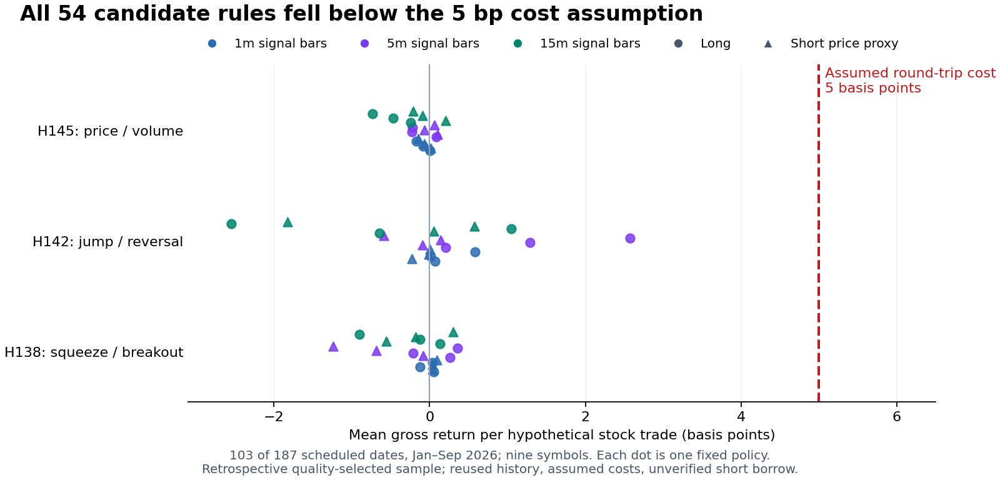

# Phase 5.69 — US intraday research result record

**Status: MEASURED — no validated edge or live promotion.** Eight explicit US
adaptations yield 135 source-directed candidates plus nine falsification
controls. All lose in the 103-day development subsample at assumed 5/10/20 bps
stock costs. In the 19-day later subsample, 3/135 candidates are positive at
5 bps and none at 10/20 bps. Two positives come from one calendar event.
Both periods remain descriptive and retrospectively quality-conditioned.
Independent quantitative review and the full repository gate passed.

The [archival contract](phase-5.69-us-intraday-research-acceptance.md) identifies
the original protocol/registry/clarification seals and the later archival
registration. [Frozen artifacts](../artifacts/research150-us/README.md) are
preserved byte for byte. Results must follow that specification without tuning.

## 1. Scope and feasibility already established

| Item | Recorded scope |
|---|---|
| Source inventory | 150 BIST/VIOP ideas; original-market hypotheses remain `NOT_TESTED`. |
| Data feasibility | 13 have OHLCV-observable components, with precise rules/dependencies still required; 58 require new adaptations; 79 lack exact required data. These are not backtest results or 13 ready strategies. |
| First pilot | H138_US_V2, H142_US_V2, H145_US_V2; nine fixed US symbols. |
| Registered search | 54 candidates + 54 paired baselines = 108 policies; 324 policy-cost views; 54 primary paired contrasts. |
| Costs | Assumed stock round-trip 5 bps primary, 10/20 bps stress; no claim of measured bid/ask fills or verified short borrow. |
| Development/reference | 2026-01-02–2026-09-30; 103 complete nine-symbol sessions out of 187 scheduled sessions. |
| Chronological evaluation | 2026-10-01–2026-11-11; 19/30 complete sessions, partly previously observed, below the 60-session gate, descriptive only. |
| News | Context only; no predictive filter or historical confluence result. |
| ThetaData | Awaiting a real Terminal response; no option result inferred from stock prices. |

The first pilot measures three families. The separately registered S1 measures
five more: H079, H080, H139, H140 and H144. Combined accounting is **324 policies,
972 cost views and 180 primary contrasts**, including all baselines and the nine
H080 short falsification controls. These are dependent alternatives, not 324
independent hypotheses or 150 tested source ideas. See section 8 and the
[S1 exposure/specification record](phase-5.69-S1-addendum-record.md).

## 2. Acquisition, coverage and exclusions

The frozen nine-symbol, 217-session acquisition attempted all **1,953
ticker-days**, certifying **1,824 ticker-days / 711,360 one-minute rows** and
excluding 129 ticker-days under the unchanged volume-quality rule. No pair
remains pending. Acquisition used **1,730 GETs: 12 initial probes plus 1,718
bulk/diagnostic requests**, including one preserved HTTP 401 and a successful
bounded recovery. Sources comprise 1,715 newly downloaded pairs, 1 recovered
diagnostic pair, 8 verified probe pairs and 229 verified cached pairs; the last
two account for the 237 initially reused pairs.

Crucially, **all 129 excluded ticker-days still have 390 unique native regular
session timestamps**. Their 146 negative per-minute volumes all match drops in
the native cumulative volume counter. Exact vendor correction semantics remain
unverified. These are volume-quality exclusions, not absent native price bars.
The certificate field `missing_timestamps` means missing *valid* rows after
rejection; it must not be interpreted as a hole in the original price timeline.
The frozen rule was preserved, without clamping volumes or selecting a different
sample after returns were observed.

The resulting common-valid cohort is **122 sessions = 103 development + 19
chronological evaluation**. The
[acquisition completion record](../artifacts/research150-us/coverage/acquisition-completion.json),
[dated coverage report](../artifacts/research150-us/coverage/missingness-report.json.gz),
[coverage verification](../artifacts/research150-us/coverage/coverage-verification.json.gz),
[request verification](../artifacts/research150-us/coverage/request-ledger-verification.json)
and [compact exclusion audit](../artifacts/research150-us/coverage/exclusion-audit-summary.json)
retain the counts and source digests. The full private manifest SHA256 is
`15e2233104e751b0354f8389ea2c51a96f4ec1769d34929e1b8c8a01ac85528e`;
the frozen dataset-plan SHA256 is
`519857050a9cc3459fd2c6809267758992d698a9c182d66a93a852820c7387db`.
Raw packets and licensed prices are excluded from this review package.

Development has **103/187 complete nine-symbol common sessions (55.08%)**. The
other 84 scheduled sessions are absent from the priced common cohort. This is
an observed subsample, not the result across all scheduled sessions. Whole-session
volume quality uses later minutes and was not known at the hypothetical entry;
the result is conditioned on retrospective quality. Missingness is not assumed
random, and missing outcomes are not zero-filled.

The [development overview](../artifacts/research150-us/development/development-overview.json)
records the conditioning and coverage. The
[run seal](../artifacts/research150-us/development/run-seal.json) binds the private
input dataset plan and coverage manifest before prices were opened. Event-time
prices are proxies; physical receipt history does not become contemporary merely
because a historical bar has a timestamp. Corporate-action adjustment semantics
and original publication latency are unverified, as retained in the
[acquisition methods](../artifacts/research150-us/coverage/acquisition-methods.txt).

This nine-symbol intraday dataset includes dates overlapping Study G's
post-2026-09-19 calendar window. The earlier
[archive search](../artifacts/research150-us/evidence/additional-archive-search.json)
**fully parsed `data/study_g/bars.csv` and hashed its bytes**, including a
duplicate checkout: all columns, including OHLCV strings, were loaded into
memory. Only schema, ticker/date/row counts and digests were analyzed/output
(140 rows, 70 symbols, September 21–22). No return labels, features, strategy
outcomes or Study G 37-feature/five-session residual-label experiment were
computed from those files. The v2/S1 run input manifests contain the independent
intraday dataset, not Study G's daily files. Its
[specification](study-G-preregistration.md) and stopping rule remain unchanged.
Metadata inspection and overlapping price dates preclude a blanket untouched-data
claim; no research-wide price blindness or wholly unopened Study G file is claimed.

## 3. Execution and integrity

The development seal is dated `2026-11-12T16:45:50.812756+00:00`; its SHA256 is
`d18471617ff4fcfb28cad4d37accfc89e2d0ed2eb97df974d979ff2f367d00ee`.
[Completion evidence](../artifacts/research150-us/development/completion-evidence.json)
records `2026-11-12T16:50:09.751619+00:00`, unchanged frozen engine hashes,
retention of every registered policy, and no chronological-evaluation price
files opened by this development run. Those are local execution records, not
independently authenticated timestamps.

The original review record reports 20 passing synthetic tests. All 20 also pass
from a clean extraction of the archived source with the recorded dependencies.
The archive retains all 324 summary rows in
[`per-trial-results.json.gz`](../artifacts/research150-us/development/per-trial-results.json.gz).
The decompressed bytes match the original JSON; both compressed and original
digests are in the
[development archive manifest](../artifacts/research150-us/development/archive-manifest.json).
The [final independent audit](../artifacts/research150-us/evidence/final-review.json)
passed 11,964 checks across 1,944 policy/period/cost summaries. The
[repository gate record](../artifacts/research150-us/evidence/repository-gate.json)
reports 7,257 passed and 52 skipped tests, strict mypy over 399 files, Ruff and
`uv lock --check` clean. This documentation/source-archive phase changes no app
runtime code; synthetic research checks and repository tests serve different
purposes.

[Independent source-provenance review](../artifacts/research150-us/evidence/phase569-source-provenance-review.json)
passes the archived coverage/source counts, original bytes and digests, native
timestamp versus volume-exclusion distinction, and both sealed runs' dataset
identities. This review concerns sources and coverage, not outcome selection or
profitability.

[Independent mechanical checks](../artifacts/research150-us/evidence/real-run-mechanical-verification.json)
passed entry latency, holding horizon, non-overlap and gross-return arithmetic
for 1,827,019 development rows and 335,237 chronological rows across the 108
alternative policies per period. These are overlapping alternative-policy
records, **not independent trades or sample size**. Eighteen native price lookups
per period, using three preselected policy IDs and first/middle/last trade
positions, and output artifact hashes also matched. These checks establish
mechanical consistency, not alpha or actual execution.

## 4. Development results

**All 54 candidates are negative at every registered cost assumption: 5, 10 and
20 bps round trip.** Their mean gross return per trade ranges from −2.5457 to
+2.5736 bps across the 54 policy means. Even the upper end is below the 5 bps
primary cost. At 5 bps, policy mean net returns span −7.5457 to −2.4264 bps.
These are ranges across alternative fixed policies, not confidence intervals,
a selected recommendation or an ensemble return.

| Family | Candidate policies | Gross mean per trade, bps: range across policies | Net mean per trade at 5 bps: range across policies | Negative at 5 / 10 / 20 bps |
|---|---:|---:|---:|---|
| H138_US_V2 | 18 | −1.2372 to +0.3613 | −6.2372 to −4.6387 | 18 / 18 / 18 |
| H142_US_V2 | 18 | −2.5457 to +2.5736 | −7.5457 to −2.4264 | 18 / 18 / 18 |
| H145_US_V2 | 18 | −0.7336 to +0.2047 | −5.7336 to −4.7953 | 18 / 18 / 18 |

All 54 fixed policy means on the **103/187 retrospectively valid development
sessions**, including reused history. These are conditional per-trade bps,
not account returns or results on the entire scheduled cohort. Every gross
policy mean falls below the assumed 5 bps round-trip cost.

All 54 candidates beat their matched baseline on net additive economics, but
**24 have no positive gross incremental advantage**. Lower turnover reduces
charged costs and can improve a losing baseline without creating alpha. The
other 30 positive gross differences also fail to establish positive absolute
net economics. All 54 baselines are negative after each cost assumption too.

The [all-54 comparison table](../artifacts/research150-us/development/all-54-candidate-views.csv)
retains both directions, all bar widths and holding periods, trade counts, gross
and net differences, cost savings, profit factors and proxy drawdowns. The
compressed per-trial report retains baselines, costs and sensitivity details.
No winning row is selected or promoted.

Additive returns use constant reference notional and equal 1/9 symbol sleeves.
Repeated losses at constant notional can sum beyond 100%; they are **not actual
account returns**. Daily-rebalanced proxy indices in the raw summaries are
separately named and do not establish self-financing execution. The per-trade
bps above avoid presenting those cumulative sums as brokerage-account losses.

## 5. Dependence, multiplicity and sensitivity

The 103 complete dates exceed the minimum day count but are too fragmented for
the frozen block-support gates. The
[joint inference record](../artifacts/research150-us/development/joint-block-inference.json)
returns `INSUFFICIENT_EVIDENCE` for both block lengths:

| Block length | Eligible contiguous starts | Unsupported analyzed sessions | Result |
|---|---:|---:|---|
| 5 sessions, primary | 12 | 71 | `INSUFFICIENT_EVIDENCE` |
| 10 sessions, sensitivity | 2 | 92 | `INSUFFICIENT_EVIDENCE` |

The requirement is at least 20 starts and support for every analyzed session.
No significance pass or simultaneous-bound claim is available from these data.
All six April–September folds remain `BLOCKED_DATA` in
[`purged-folds.json`](../artifacts/research150-us/development/purged-folds.json).
Full-interval purge checks find zero overlaps and zero parameters are fitted;
zero purged rows does not repair missing coverage. Leave-largest-gain-day-out
and leave-one-symbol-out summaries remain in the per-trial archive as diagnostic
outputs, not alternate selected samples.

**DSR: `INSUFFICIENT_EVIDENCE`.** The prior search history is incompletely known;
the pilot's 54 contrasts do not reset it. Descriptive negative economics and
insufficient inferential support are separate findings.

## 6. Chronological period — measured, descriptive only

The [chronological overview](../artifacts/research150-us/evaluation/chronological_evaluation-overview.json)
and [all-54 comparison table](../artifacts/research150-us/evaluation/all-54-candidate-views.csv)
retain the complete fixed candidate registry; all 324 policy-cost summary rows
are preserved in
[`per-trial-results.json.gz`](../artifacts/research150-us/evaluation/per-trial-results.json.gz).
Only **19/30 scheduled sessions (63.33%)** have complete nine-symbol coverage.
The same retrospective whole-session quality conditioning applies. This partly
previously observed period is not an untouched holdout.

| Period | Complete / scheduled sessions | Positive candidates at 5 bps | At 10 bps | At 20 bps |
|---|---:|---:|---:|---:|
| Development, Jan–Sep | 103 / 187 | 0 / 54 | 0 / 54 | 0 / 54 |
| Chronological, Oct–Nov | 19 / 30 | 1 / 54 | 0 / 54 | 0 / 54 |

The single positive chronological 5 bps row is
`H142_US_V2_b15_h01_long_candidate`: 15-minute signal bars, 1-minute hold, 24
trades, mean gross +5.2394 bps/trade, mean net **+0.2394 bps/trade**, and profit
factor 1.0763. It becomes negative at 10 and 20 bps. At the stated $10,000 fixed
reference notional with 1/9 symbol sleeves its additive proxy PnL is +$0.6385;
this is not executable account profit. This row is disclosed to account for all
outcomes, not selected as a winner or a recommendation.

All 54 candidates again exceed their losing baselines on net additive economics;
29 have no positive gross incremental difference. Reduced charged turnover costs
remain an explanation for relative improvement, not an alpha finding. All 54
baselines are negative at all three costs.

Both [inference blocks](../artifacts/research150-us/evaluation/joint-block-inference.json)
return `INSUFFICIENT_EVIDENCE` for fewer than 60 complete daily clusters. DSR is
also `INSUFFICIENT_EVIDENCE`. The six `BLOCKED_DATA` fold entries in this
phase-specific raw runner output are empty development-fold context, **not six
chronological evaluation folds**. No confirmation/significance pass, retuning or
“untouched holdout” claim follows from these results.

The [evaluation seal](../artifacts/research150-us/evaluation/run-seal.json) has
SHA256 `c45b702ff3f2f3a122d0a7b2ae9fe93bcfbe5052194e139555593020ee0d2d82`.
Archive identities are recorded in the
[evaluation manifest](../artifacts/research150-us/evaluation/archive-manifest.json).
[Completion evidence](../artifacts/research150-us/evaluation/completion-evidence.json)
records completion at `2026-11-12T16:54:40.833930+00:00`, unchanged code and rules
after development, and the output hashes. Consolidated independent review passed; its complete
[record](../artifacts/research150-us/evidence/final-review.json) is retained.

## 7. News source diagnosis — undeployed proposal

The [compact coverage record](../artifacts/research150-us/evidence/news/coverage-summary-compact.json)
contains six physically timestamp-verified candidate-cohort records but **zero
timely, source-bound semantic records with a usable non-unknown direction**.
The full daily export was unavailable after a timeout and subsequent busy
responses; fallback coverage is limited to the candidate cohort. News therefore
remains context only, with no measured predictive contribution.

The [export diagnosis and proposal](../artifacts/research150-us/evidence/news/export-bottleneck-proposal.json)
reproduced 1,733 SQL statements for 64 scans × 9 tickers, despite only nine unique
packets, in a synthetic profile of unchanged code. A process-wide lock covers
the whole audit; the server thread can continue holding it after the client
times out. A work-only paginated prototype uses three SELECT queries per page
(plus one opening manifest query), and its
[13 synthetic tests pass](../artifacts/research150-us/evidence/news/prototype-validation.json).
This is **UNDEPLOYED** and is not a live fix or PostgreSQL performance result.
HTTP integration, authentication/cursor scope, response/decompression/runtime
caps, cancellation handling and real PostgreSQL verification remain required.
The [undeployed prototype source snapshot](../artifacts/research150-us/evidence/news/news-source-page-prototype.zip)
includes original source/test hashes for review. The corrected proposal calls
`available_at` a stored original physical receipt time with validated packet
binding: the existing unkeyed checksum does **not** cryptographically sign that
time and does not include `available_at`.

## 8. S1 and combined findings

S1 completed unchanged: **81 source-directed candidates, nine H080 short
falsification controls and 126 fixed baselines**, at all three costs. Its
[overview](../artifacts/research150-us/supplement-s1/supplement-overview.json),
[all-216 policy CSV](../artifacts/research150-us/supplement-s1/all-216-policy-results.csv),
[full 648 cost-view records](../artifacts/research150-us/supplement-s1/per-policy-results.json.xz)
and [all 126 paired contrasts across periods/costs](../artifacts/research150-us/supplement-s1/all-126-paired-contrasts-all-costs-periods.json.gz)
retain the entire registry. Compression preserves the original result bytes;
[transport instructions](phase-5.69-archive-transport.md)
explain recovery and hash verification. No candidate or control is a no-trade
path, and zeros are not counted as profitable.

| Source-directed candidates positive | Development: 103/187 dates, 5 / 10 / 20 bps | Chronological: 19/30 dates, 5 / 10 / 20 bps |
|---|---:|---:|
| First pilot: 54 | 0 / 0 / 0 | 1 / 0 / 0 |
| S1: 81 | 0 / 0 / 0 | 2 / 0 / 0 |
| Combined: 135 | 0 / 0 / 0 | 3 / 0 / 0 |

All nine H080 short controls and all 180 baseline entries lose at every cost in
both periods. S1's two positive later-period rows are H079 15-minute short
policies with five- and fifteen-minute holds. Each has 66 hypothetical trades,
all on **October 30 alone**, across the nine symbols. Net means at 5 bps are
+1.8178 and +2.2706 bps/trade; both fail the 10 bps cost stress after negative
development results. These are two policy views of one calendar event, not
66 independent event observations or verified executable shorts. No positive
calendar-alpha conclusion follows from this concentration.

The [joint 180-contrast inference](../artifacts/research150-us/supplement-s1/joint-combined180-inference.json)
retains both H139/H140 baselines and the first pilot's contrasts. Development
fails the unchanged contiguous-block-support gates; the later period has fewer
than 60 complete day clusters. DSR remains insufficient evidence. The six
expanding development folds remain blocked by incomplete common coverage.
Relative improvement through less trading and lower charged costs does not
establish positive absolute expectancy.

S1 [completion evidence](../artifacts/research150-us/supplement-s1/completion-evidence.json)
binds the final outputs. No threshold, formula, sample rule or engine code was
changed after its own outcomes were opened. Its specification author had not
read v2 outcomes, but its runner author had; S1 is not a globally blind test.
The five other OHLCV-observable ideas retain explicit nonexecuted dispositions
in the supplement proposal: volume periodicity without a trading direction;
unverified corporate actions; sparse holiday events and incompatible warm-up;
and two incompletely specified risk/filter overlays.

## 9. Final review and delivery

**No validated edge; no live promotion.** Negative observed economics under the
assumed costs and insufficient formal inference are separate findings. These
results do not establish profitability on excluded dates, measure actual
bid/ask stock fills, or establish an option/news confluence effect.

The [independent quantitative audit](../artifacts/research150-us/evidence/final-review.json)
passed **11,964 checks**, zero failures, across 1,944 policy/period/cost summary
rows. Its [complete checked table](../artifacts/research150-us/evidence/final-all-policy-checks.csv.gz)
retains every arm. The [repository gate](../artifacts/research150-us/evidence/repository-gate.json)
passed 7,257 tests with 52 skipped, strict mypy on 399 files, Ruff and lockfile
checks. Skipped provider tests do not verify live access. Clean source archives
pass the 20 v2 and 13 S1 synthetic checks; the undeployed news prototype passes
13 separate checks.

The [closeout](phase-5.69-closeout.md) consolidates scope, validation and the next
external step. The compact archive retains original-byte hashes, safe source
ZIPs and all result records below its 2 MB budget; licensed price/news packets
remain private. Application runtime, signal profiles and historical decisions
are unchanged. Real ThetaData ingestion still requires the Mac connector to
supply its first provider response; eight fixed option requests are queued.
